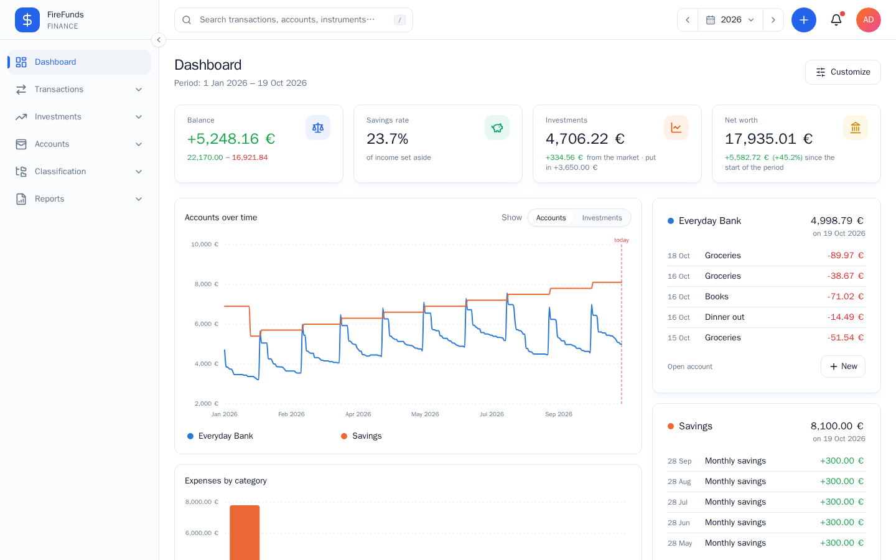
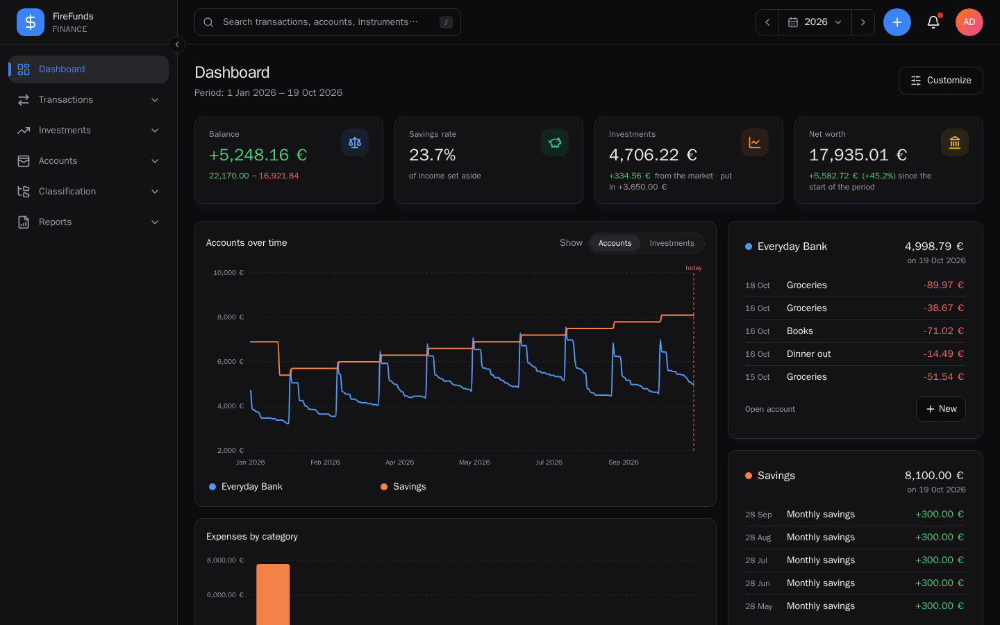
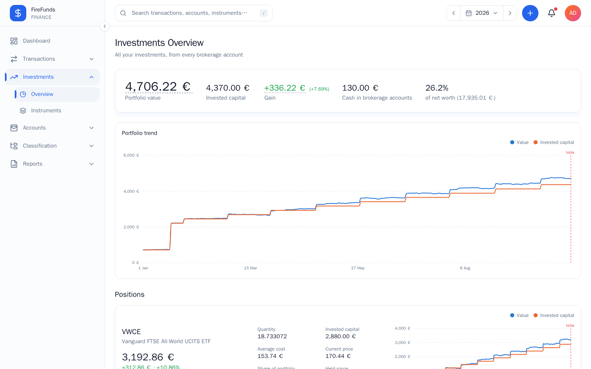
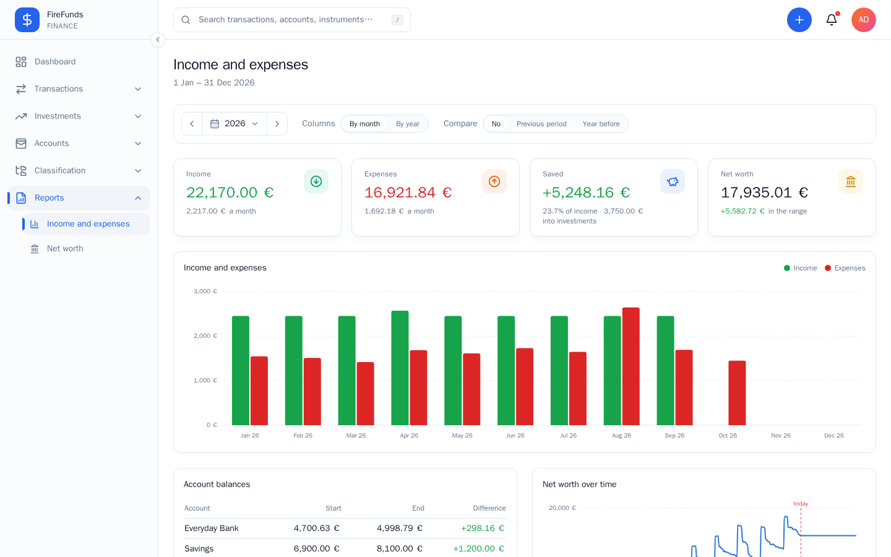
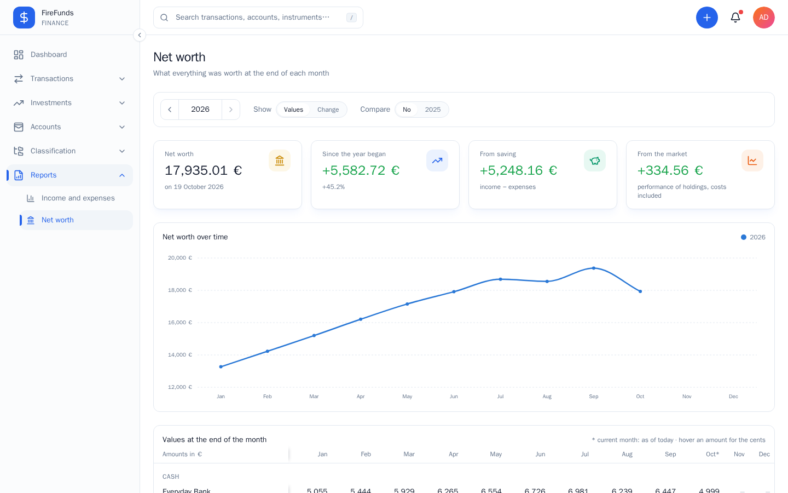
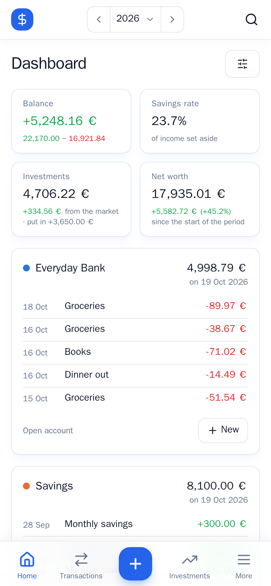
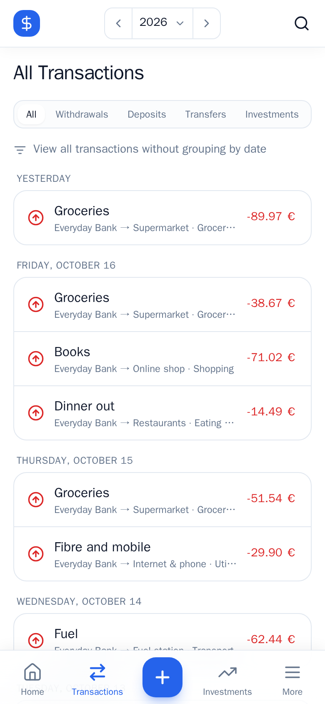
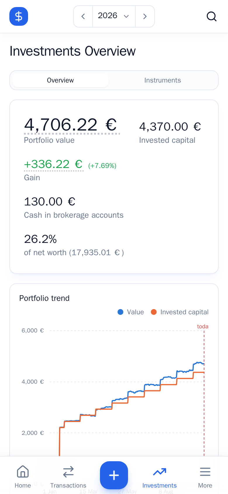

# FireFunds

[](LICENSE)

**Know where your money goes.**

FireFunds is a self-hosted personal finance app. You record where your money is (bank accounts, cards, cash, brokers), who you pay and who pays you, and FireFunds shows you balances, spending by category, savings rate, investments and net worth over time. It runs on your own server as a single Docker image, works in the browser and installs on your phone as an app (PWA). Your data never leaves your machine.

It uses double-entry bookkeeping, like [Firefly III](https://www.firefly-iii.org), which inspired it, with first-class support for investments: ETF and stock positions, daily prices, gains and the estimated tax if you sold today.

> **Status:** personal project, used daily by its author and under active development. Multi-currency up to a point (see [Limitations](#limitations)). Interface in English and Italian.

**Italiano:** [la descrizione e l'installazione in italiano](#in-italiano) sono in fondo alla pagina.

## Screenshots

<table>
  <tr>
    <td width="50%"><br><sub>Dashboard</sub></td>
    <td width="50%"><br><sub>Dashboard, dark theme</sub></td>
  </tr>
  <tr>
    <td width="50%"><br><sub>Investments overview</sub></td>
    <td width="50%"><br><sub>Income and expenses report</sub></td>
  </tr>
  <tr>
    <td colspan="2"><br><sub>Net worth report</sub></td>
  </tr>
</table>

<table>
  <tr>
    <td width="33%"><br><sub>Phone: dashboard</sub></td>
    <td width="33%"><br><sub>Phone: transactions</sub></td>
    <td width="33%"><br><sub>Phone: investments</sub></td>
  </tr>
</table>

_Fictional sample data._

## What it does

### Money in, money out

Every transaction moves money between two accounts, so the books always balance:

- **Asset accounts** are where your money is: checking, savings, cash, credit card, broker.
- **Expense accounts** are who you pay (supermarket, landlord, online shop…), **revenue accounts** who pays you (employer, refunds…).
- **Categories** say why (groceries, housing, travel…); **tags** group anything else (a holiday, a project).

```
€67.58 at the supermarket

Checking account  -67.58 €
Supermarket       +67.58 €     category: Groceries
```

Withdrawals, deposits and transfers can be created, edited, cloned and deleted, each with its own change history. A side can be left empty (a gift you received, cash you gave away). Nothing is ever really deleted: deleted data stays in the database, out of sight.

### Dashboard

For any period (this month, this year, a range of your choice): income, expenses, balance and savings rate; investments and their market gain; net worth and how it changed. Charts of balances or instrument prices, spending by category and by expense account, and a box per chosen account with its latest transactions.

### Investments

- Instruments (ETF, stocks, bonds, funds, crypto…) with a Yahoo Finance ticker; **daily closing prices** fetched automatically four times a day and kept for every day, weekends included.
- **BUY / SELL** trades on broker accounts, with fees and taxes. The amount is what the broker actually charged (a 50.00 monthly plan that bought 0.300987 units at 166.12, not 49.99996).
- A broker account holds both **cash** and **positions**: value, gain, average cost (average-cost method), weight, holding period.
- **Overview** across every broker: portfolio value, invested capital, gain, share of net worth, one row per instrument even if held on two brokers, contributions by month.
- **Estimated capital gains tax** if you sold today, at your rate (26% by default) or the instrument's own (e.g. 12.5% on government bonds, or worked out from an ETF's white-list share).

### Reports

- **Income and expenses**: a column per month or per year over any range, optionally compared with the range before or the year before; income, expenses, savings, net worth, and a category × month table where every cell opens its transactions.
- **Net worth**: a year at a time, every account and instrument at the end of each month, and each month's change split into what you saved and what the market did.

### Everything else

- Multi-user, every record scoped to its owner; the first user to register is the admin, who can close registrations and add, edit and disable users (Administration → Users).
- Light and dark theme (or follow the device), Italian and English, your own number format and timezone.
- Search across descriptions, notes, accounts, categories and tags.
- JWT login with single-use refresh tokens (a replayed one signs the session out), logout and password changes that end sessions, and login throttling (5 failed attempts per email and IP lock it for up to 15 minutes).

## Installation

**Requirements:** a server with Docker and Docker Compose. One image, `ghcr.io/nicolopozzato/firefunds`, holds the whole app.

```bash
mkdir firefunds && cd firefunds
curl -O https://raw.githubusercontent.com/nicolopozzato/firefunds/main/compose.yml
curl -O https://raw.githubusercontent.com/nicolopozzato/firefunds/main/.env
```

Open `.env`, set `DOMAIN` and fill in the 3 secrets (`POSTGRES_PASSWORD`, `APP_SECRET`, `JWT_PASSPHRASE`), each with its own value from:

```bash
openssl rand -hex 32
```

Start:

```bash
docker compose up -d
```

The app is at `http://127.0.0.1:8080` (check: `curl http://127.0.0.1:8080/api/health`). Open it, register: the first user becomes the admin. Then create your accounts, a few categories, and start recording transactions; for investments, create the instruments first.

Everything FireFunds stores is in `./data` (database, login keys, scheduler state, backups).

| Service     | What it does                                                      |
|-------------|-------------------------------------------------------------------|
| `database`  | PostgreSQL 18                                                     |
| `app`       | FrankenPHP: the web app on `/`, the API on `/api`                 |
| `scheduler` | Background jobs: investment prices, exchange rates, backups, expired sessions (Administration → Scheduled tasks shows when each runs and how it went) |

### HTTPS (reverse proxy)

The app only speaks plain HTTP on `127.0.0.1`. To reach it from outside, put it behind a reverse proxy. With Traefik and an existing external `proxy` network, create a `compose.override.yml` next to `compose.yml`:

```yaml
services:
  app:
    ports: !reset []
    networks:
      - default
      - proxy
    labels:
      traefik.enable: "true"
      traefik.docker.network: "proxy"
      traefik.http.routers.firefunds.rule: "Host(`${DOMAIN}`)"
      traefik.http.routers.firefunds.entrypoints: "websecure"
      traefik.http.services.firefunds.loadbalancer.server.port: "8000"

networks:
  proxy:
    external: true
```

Then `docker compose up -d` again. With another proxy (nginx, Caddy, Cloudflare Tunnel), skip the override and point it at `127.0.0.1:8080`.

Login throttling counts failed attempts by the client's address, which the app reads from `X-Forwarded-For` when the request comes from a private network (`TRUSTED_PROXIES` in `.env`). Your proxy must add the client's address to that header rather than pass on what the client sent: Traefik, Caddy and nginx with `$proxy_add_x_forwarded_for` do.

The register page is open until the first account exists, and that account is the administrator: create it before the app is reachable from the internet.

### Updating

```bash
docker compose pull && docker compose up -d
```

Database migrations run by themselves when the new version starts, so make a backup first (Administration → Backups → Back up now). To stay on a known version, set `FIREFUNDS_TAG` in `.env` (e.g. `1.2.0`, or `1.2` for its latest patch) instead of `latest`.

**Coming from a release up to 0.3.0 (PostgreSQL 16):** the database is now PostgreSQL 18, and a PostgreSQL data folder can't be opened by another major version, so the data goes through a dump. In the folder with `compose.yml`, with the old version still running:

```bash
docker compose exec database pg_dump -U firefunds -Fc firefunds > firefunds_pg16.dump
docker compose down
mv data/postgres data/postgres_16        # kept, in case you need to go back
curl -O https://raw.githubusercontent.com/nicolopozzato/firefunds/main/compose.yml
docker compose pull && docker compose up -d database
docker compose exec -T database pg_restore -U firefunds -d firefunds --no-owner --no-acl --exit-on-error < firefunds_pg16.dump
docker compose up -d
```

The new `compose.yml` also has the backups volume, so after this the data is backed up as described below. Delete `data/postgres_16` once you are sure everything is there.

### Backup and restore

FireFunds backs up its own database: once a day, keeping the last 14 days, in `./data/backups` (one `firefunds_<date>_v<version>.tar` file each). The administrator changes how often and how long, makes one on the spot and downloads them in **Administration → Backups**.

**A backup on the same disk is not enough.** To be able to rebuild everything elsewhere, keep a copy, somewhere else (another machine, cloud storage), of:

1. `compose.yml` and `.env` (the secrets in it: `POSTGRES_PASSWORD`, `APP_SECRET`, `JWT_PASSPHRASE`);
2. a backup file from `./data/backups` (download it from the app, or copy the newest one);
3. optionally `./data/jwt`: without it everyone simply logs in again.

**Restore** (on the same server, or on a new one with your `compose.yml` and `.env` in place and the backup file copied into `./data/backups`). Run the commands in the folder with `compose.yml`:

```bash
docker compose stop app scheduler
docker compose run --rm -e RUN_MIGRATIONS=0 app php bin/console app:backup:restore firefunds_20261021_030500_v0.3.0.tar
docker compose up -d
```

This **replaces all the data** with the backup's, after asking for confirmation and saving what is there now as a backup of its own. It also checks the version first:

- a backup from the **same version** is put back as it is;
- from an **older version**: it is put back, then the database migrations that came after it run;
- from a **newer version**: it is refused, telling you which version made it. Update FireFunds (`FIREFUNDS_TAG` in `.env`, or `latest`) and try again.

Backups made by hand with `pg_dump` (before this existed) are restored with `pg_restore` instead.

**Upgrading from a version without backups:** add `- ./data/backups:/app/backend/var/backups` to the `volumes:` of `x-app` in your `compose.yml` (or download the new one), otherwise the backups stay inside the container and are lost when it is recreated; the Backups page warns you if it is missing.

## Limitations

- **Currencies, up to a point.** Every account has its currency, every instrument its quote currency, and you choose the one amounts are shown in (Preferences). Wherever accounts are added up (dashboard, reports, net worth, totals) each amount is converted at its day's rate: ECB reference rates, Yahoo for a currency the ECB doesn't publish, and you can correct any day for yourself (Preferences → Exchange rates). A transfer between currencies takes the amount that arrived. Not there yet: a broker account holding cash in two currencies (use two accounts), and splitting a gain into price and exchange.
- **The current price is the last close** (yesterday's at best), not a live quote.
- Selling more units than you hold is not blocked, like overdrawing a checking account.

## Roadmap

- Live quotes, realized gains on sales, dividends.
- Split transactions, reconciliation.
- Imports (bank CSV, payment notifications) with proposed transactions to confirm, optionally AI-assisted classification.

## Contributing

Issues and pull requests are welcome. [CONTRIBUTING.md](CONTRIBUTING.md) explains how to run FireFunds locally (one command, with [Lando](https://lando.dev)), how the code is organized and the rules it follows.

**Tech stack:** PHP 8.5, Symfony 8.1, PostgreSQL 18, [FrankenPHP](https://frankenphp.dev); React 18, TypeScript, Vite, shadcn/ui, TanStack Query, i18next.

## Security

Please don't open a public issue for a vulnerability: see [SECURITY.md](SECURITY.md).

## In italiano

FireFunds è un'app per le finanze personali da installare sul proprio server. Registri dove sono i tuoi soldi (conti, carte, contanti, broker), chi paghi e chi ti paga, e FireFunds ti mostra saldi, spese per categoria, tasso di risparmio, investimenti e patrimonio netto nel tempo. Gira come una sola immagine Docker, si usa dal browser e si installa sul telefono come app (PWA). I tuoi dati restano sul tuo server.

Usa la partita doppia, come [Firefly III](https://www.firefly-iii.org) da cui prende ispirazione, e gestisce gli investimenti: posizioni in ETF e azioni, prezzi giornalieri, guadagni e la stima delle tasse se vendessi oggi. Interfaccia in italiano e in inglese; per ora solo in **euro**.

### Cosa fa

- **Entrate e uscite**: ogni transazione sposta denaro fra due conti (i tuoi conti, chi paghi, chi ti paga), con categorie, etichette e la cronologia delle modifiche. Niente viene mai cancellato davvero.
- **Dashboard** per qualsiasi periodo: entrate, uscite, risparmio, investimenti, patrimonio netto e grafici.
- **Investimenti**: strumenti con ticker Yahoo Finance e prezzi di chiusura scaricati in automatico, acquisti e vendite con commissioni e tasse, posizioni con prezzo medio di carico, panoramica su tutti i broker e la stima del capital gain (26% di default, o l'aliquota del singolo strumento, es. 12,5% sui titoli di Stato).
- **Report**: entrate e uscite per mese o per anno con confronto, e il patrimonio netto mese per mese.
- Più utenti, ognuno con i suoi dati; il primo che si registra è l'amministratore. Tema chiaro e scuro, formato dei numeri e fuso orario a scelta, ricerca.

### Installazione

Serve un server con Docker e Docker Compose.

```bash
mkdir firefunds && cd firefunds
curl -O https://raw.githubusercontent.com/nicolopozzato/firefunds/main/compose.yml
curl -O https://raw.githubusercontent.com/nicolopozzato/firefunds/main/.env
```

Apri `.env`, imposta `DOMAIN` e compila i 3 segreti (`POSTGRES_PASSWORD`, `APP_SECRET`, `JWT_PASSPHRASE`), ognuno con un valore diverso generato da `openssl rand -hex 32`. Poi avvia:

```bash
docker compose up -d
```

L'app risponde su `http://127.0.0.1:8080`. Aprila e registrati: il primo utente diventa l'amministratore, quindi crealo **prima** di rendere l'app raggiungibile da internet. Tutto quello che FireFunds salva è in `./data` (database, chiavi di accesso, backup).

**HTTPS:** l'app parla solo HTTP su `127.0.0.1`; mettila dietro un reverse proxy (Traefik, Caddy, nginx, Cloudflare Tunnel). L'esempio per Traefik è nella sezione [HTTPS](#https-reverse-proxy). Il proxy deve aggiungere l'indirizzo del client all'header `X-Forwarded-For`, che serve al blocco dei tentativi di accesso falliti.

**Aggiornare:** `docker compose pull && docker compose up -d` (dalle versioni fino alla 0.3.0, con PostgreSQL 16, il passaggio a PostgreSQL 18 richiede un dump: i comandi sono nella sezione *Updating* in inglese). Le migrazioni del database partono da sole all'avvio, quindi fai prima un backup (Amministrazione → Backup → Fai un backup ora). Se aggiorni da una versione senza backup, aggiungi `- ./data/backups:/app/backend/var/backups` ai `volumes:` di `x-app` in `compose.yml` (o riscaricalo).

**Backup e ripristino:** FireFunds fa da solo un backup del database ogni giorno e tiene gli ultimi 14 giorni in `./data/backups`; l'amministratore cambia frequenza e durata, ne fa uno al volo e li scarica da **Amministrazione → Backup**. Per poter ricostruire tutto altrove, tieni una copia **fuori da questo server** di `compose.yml`, `.env` (con i segreti) e di un file di backup. Per ripristinare (nella cartella con `compose.yml`, con il file di backup in `./data/backups`):

```bash
docker compose stop app scheduler
docker compose run --rm -e RUN_MIGRATIONS=0 app php bin/console app:backup:restore firefunds_20261021_030500_v0.3.0.tar
docker compose up -d
```

Il ripristino **sostituisce tutti i dati** (chiede conferma e prima salva quelli attuali come backup). Controlla la versione: un backup della stessa versione torna com'è, uno di una versione precedente viene riportato e poi aggiornato con le migrazioni, uno di una versione **più recente** viene rifiutato indicando quale versione l'ha fatto (aggiorna FireFunds e riprova).

### Limiti

- **Valute, fino a un certo punto**: ogni conto ha la sua valuta, ogni strumento la sua valuta di quotazione, e scegli tu quella in cui vedere gli importi (Preferenze). Dove si sommano i conti (dashboard, report, patrimonio, totali) ogni importo è convertito al cambio del suo giorno: tassi BCE, Yahoo per quelli che la BCE non pubblica, e puoi correggere un giorno solo per te (Preferenze → Cambi). Un trasferimento tra valute prende l'importo arrivato. Non c'è ancora: un conto di un broker con liquidità in due valute (usa due conti) e la divisione del guadagno tra prezzo e cambio.
- Il prezzo attuale di uno strumento è l'ultima chiusura, non una quotazione in tempo reale.

Segnalazioni e contributi sono benvenuti, in italiano o in inglese: vedi [CONTRIBUTING.md](CONTRIBUTING.md). Per le vulnerabilità, [SECURITY.md](SECURITY.md).

## License

[GNU AGPL v3.0](LICENSE): you can use, modify and self-host FireFunds freely; if you offer a modified version as a service, you must publish your changes under the same license.
